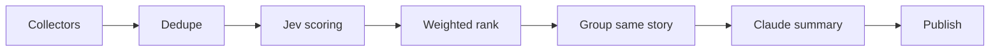

# What's New Digest (AKD)

A daily, unattended pipeline that collects AI and coding news, scores each item against a reader profile, ranks it, and publishes a short list: "Top picks" and "Also notable". AKD stands for Automated Knowledge Discovery.

Each run writes two outputs:

- `whats-new.md` in this repo, newest entry first.
- `public/whats-new/items.json` in a separate site repo, validated against `akd/schema/items.schema.json`, which feeds a What's New tab on a personal website.

## How it works



1. **Collect.** Each source is a collector with `collect() -> list[Item]`. A failing collector is logged and skipped; the run continues.
   - Web feeds (RSS/Atom), GitHub (topics and a release watchlist), Reddit, YouTube.
   - X, through an Apify actor. Off unless `APIFY_TOKEN` is set.
   - Email newsletters from a dedicated Gmail inbox, read-only over IMAP. Off unless `GMAIL_ADDRESS` and `GMAIL_APP_PASSWORD` are set.
2. **Dedupe** by canonical URL and title, and against items already published.
3. **Score** every item with [Jev](https://typesafe.ai), a TypeSafe System One model. Jev judges category, significance, relevance to `profile.yaml`, actionability, novelty and a hype probability.
4. **Rank in code.** Weights live in `config.yaml` and are applied after scoring, so changing them never re-runs inference.
5. **Group** near-duplicate stories (pairwise "same story" probability from Jev) so one story takes one slot.
6. **Summarize.** Claude writes a one-line "why it matters" for the selected items only.
7. **Publish** to `whats-new.md` and the site repo.

## Usage

Requires Python 3.12 or newer.

```bash
python -m venv .venv && source .venv/bin/activate   # Windows: .venv\Scripts\activate
pip install -e ".[dev]"
pytest -q

# collect, rank, and write to ./out without touching any repo
python -m akd.cli run --dry-run

# score a live sample and print the top and bottom, to tune weights
python -m akd.cli tune --top 20
# then edit `weights` in config.yaml and re-rank from the cached scores for free
python -m akd.cli tune --from-cache
```

### Environment variables

| Variable | Needed for |
|---|---|
| `TYPESAFE_API_KEY` | Jev scoring and grouping (required) |
| `ANTHROPIC_API_KEY` | One-line summaries (required) |
| `APIFY_TOKEN` | X posts, and the YouTube fallback when a channel feed is down (optional) |
| `GMAIL_ADDRESS`, `GMAIL_APP_PASSWORD` | Email newsletters (optional) |
| `GITHUB_TOKEN` | Higher GitHub API rate limits (optional) |

## Configuration

- `config.yaml`: weights, pick caps, freshness window, subreddits, feeds, GitHub topics and watchlist, YouTube channels, X handles, and email senders.
- `profile.yaml`: who the reader is (role, stack, interests, things to ignore). It is passed to Jev as state so "relevance" is judged against real context. **Edit this to make the digest yours.**
- `akd/levels.py`: the wording of the Jev questions and level descriptions.

## Scheduling

`.github/workflows/akd.yml` runs daily at 13:30 UTC and can be triggered by hand. A manual run defaults to a dry run that uploads `out/` as an artifact and pushes nothing. Publishing needs these repository secrets: `TYPESAFE_API_KEY`, `ANTHROPIC_API_KEY`, `SITE_REPO_TOKEN` (a fine-grained token with write access to the site repo), and optionally `APIFY_TOKEN`, `GMAIL_ADDRESS` and `GMAIL_APP_PASSWORD`. If you fork this, point the `repository:` line in the workflow at your own site repo.

## Adding a source

Create `akd/collectors/<name>.py` with a class that has a `name` and `collect() -> list[Item]` (see `akd/collectors/web.py`), take an injected `httpx.Client` so tests can mock transport, then register it in `akd/cli.py`.

## Layout

```
akd/            pipeline: collectors/, dedupe, score, rank, group, summarize, publish
config.yaml     weights, caps and source lists
profile.yaml    the reader profile
tests/          pytest suite with recorded fixtures
docs/akd/       design doc and implementation plan
skills/akd/     Claude Code skill for running and tuning the pipeline
whats-new.md    the published digest
```

## Notes

- No license file is included yet, so by default all rights are reserved. Add one if you want others to reuse the code.
- Newsletter links in email carry per-subscriber tokens, so the email collector logs only the host and HTTP status for dropped links, never the URL.
